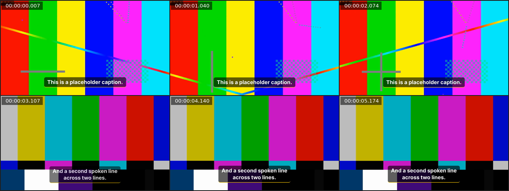

# remotion-ffmpeg-skill

**ffmpeg-skill measures the footage. Remotion draws from those measurements. ffmpeg-skill checks and delivers the result.**

An [Agent Skill](https://docs.claude.com/en/docs/agents-and-tools/agent-skills/overview) for Claude Code, Cursor and Codex that puts Remotion motion graphics on *real recordings* — and never guesses a number. Composition length, fps and frame size come from the probe; cuts come from measured silences; pulses hit on measured audio peaks; captions keep the timing of your SRT. Every render is verified frame-for-frame against its timeline and inspected with a contact sheet before it ships.

Built on [**ffmpeg-skill**](https://github.com/kajisho5/ffmpeg-skill). Unofficial — not affiliated with Remotion.



## Why this and not just Remotion's own skills?

[Remotion's official Agent Skills](https://www.remotion.dev/docs/ai/skills) teach an agent to *write* good Remotion code. This skill closes the loop around it:

| | Remotion skills | remotion-ffmpeg-skill |
|---|---|---|
| Writes Remotion compositions | ✅ | ✅ (three ready-made, timeline-driven) |
| Knows the source's real duration / fps / size / silences / scene cuts / audio peaks | — | ✅ measured by ffmpeg-skill |
| Warns before drawing on VFR or HDR footage | — | ✅ |
| Verifies the render (exact frame count, fps, size, audio) | — | ✅ non-zero exit on mismatch |
| Looks at the result (contact sheet) | — | ✅ |
| Delivers for YouTube / Reels / TikTok / Shorts / X with loudness and compliance checks | — | ✅ ffmpeg-skill templates + `check.py` |

They work well together: install both if you write custom compositions.

## Install

```bash
npx ffmpeg-skill              # the measuring/delivery half (required)
npx remotion-ffmpeg-skill     # this skill, next to it in ~/.claude/skills
```

`--cursor`, `--codex`, `--all`, `--project` work for both. Requirements: Python 3.10+, Node.js 18+, FFmpeg (ffmpeg-skill's `doctor` tells you what's missing). Remotion's headless browser downloads itself on the first render.

## What you can ask for

- "Put animated captions from `talk.srt` on `talk.mp4` and make it a YouTube upload."
- "Cut the silences out of this recording, jump-cut style, and keep the subtitles in sync."
- "Make graphics that hit on the loud moments of `clip.mp4`, as a Reel."

## Under the hood

```bash
S=~/.claude/skills/remotion-ffmpeg-skill/scripts

python3 $S/init.py ./motion --install                       # Remotion project (pinned versions)
python3 $S/analyze.py talk.mp4 --captions talk.srt          # -> talk.timeline.json (all measured)
python3 $S/still.py  --project ./motion --comp Jumpcut --timeline talk.timeline.json --at 2
python3 $S/render.py --project ./motion --comp Jumpcut --timeline talk.timeline.json -o jumpcut.mp4
python3 $S/deliver.py jumpcut.mp4 --platform youtube        # template + compliance table

# or all of it, each step verified before the next:
python3 $S/pipeline.py talk.mp4 --project ./motion --comp Jumpcut --captions talk.srt --platform youtube
```

Every script takes `--json`, `--dry-run`, `--overwrite`, `--timeout`, like ffmpeg-skill.

### Compositions

| Id | Length | What it draws |
|---|---|---|
| `Captioned` | source duration | caption cards that spring in on each cue (text exactly as written) |
| `Jumpcut` | sum of measured speech ranges | silences removed, punch-in on every other cut, captions re-timed |
| `PeakPulse` | source duration | edge glow + zoom on measured audio peaks, flash on scene cuts, progress bar |

Colours, font, caption size, zoom and pulse strength are options (`--options look.json`); the timeline format and every option are in [`references/timeline.md`](references/timeline.md). Add your own composition to the generated project and render it with `--comp YourId`.

### What render.py verifies

```text
jumpcut.mp4: 6.32 s, 1280x720, 30.0 fps, audio
  size      PASS  1280x720 (expected 1280x720)
  fps       PASS  30.0 (expected 30.0)
  frames    PASS  189 (expected 189)
  audio     PASS  present (expected present)
Look: jumpcut_sheet.png
```

Frame numbers are `Math.round(seconds × fps)` on both sides (TypeScript and Python), so the expected count is exact, not "close enough".

## Licence

This skill is MIT. **Remotion itself has its own licence**: free for individuals and for-profit organisations with up to 3 employees; larger companies need a [Remotion company licence](https://www.remotion.dev/license). Using this skill does not change that.

## Status

0.1.0 — first release. Planned: MCP server and machine-readable contract (as in ffmpeg-skill), beat-grid driven composition, transparent overlay renders (ProRes 4444) composited by ffmpeg-skill, more templates (lower-thirds, titles from scene cuts), demo GIF.
