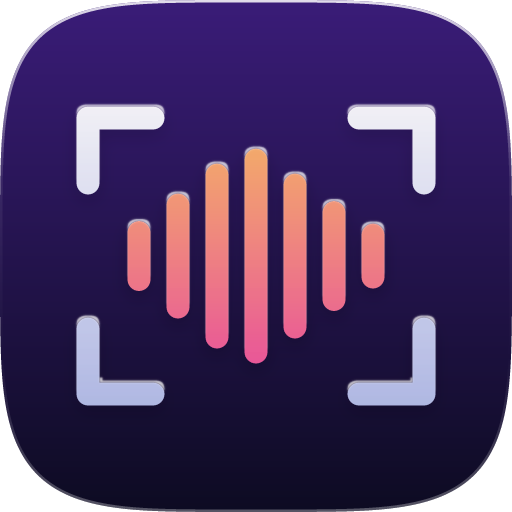
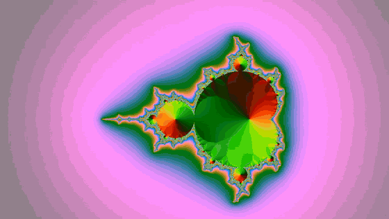
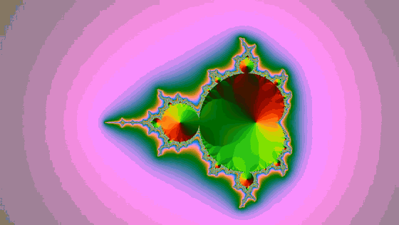
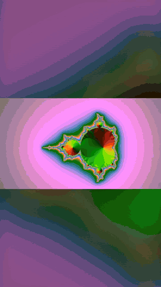
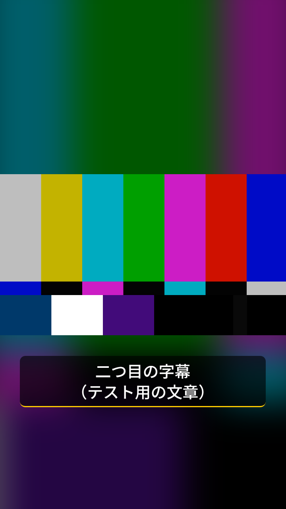

<p align="center"></p>

<p align="center">
  <picture>
    <source media="(prefers-color-scheme: dark)" srcset="brand/logo/wordmark-white.svg">
    
  </picture>
</p>

**ffmpeg-skill measures the footage. Remotion draws from those measurements. ffmpeg-skill checks and delivers the result.**

An [Agent Skill](https://docs.claude.com/en/docs/agents-and-tools/agent-skills/overview) for Claude Code, Cursor and Codex that puts Remotion motion graphics on *real recordings* — and never guesses a number. Composition length, fps and frame size come from the probe; cuts come from measured silences; pulses hit on measured audio peaks; captions keep the timing of your SRT. Every render is verified frame-for-frame against its timeline and inspected with a contact sheet before it ships.

Built on [**ffmpeg-skill**](https://github.com/kajisho5/ffmpeg-skill). Unofficial — not affiliated with Remotion.



<sub>Fictional demo footage. ffmpeg-skill measured two silences and a scene cut; Remotion played only the speech ranges with punch-in zooms and re-timed captions; render.py verified 201 of 201 frames.</sub>

<table>
<tr>
<td width="62%"><br><sub><b>Karaoke</b> — words light up at their measured times (250 / 250 frames verified)</sub></td>
<td width="38%"><br><sub><b>9:16 + Japanese</b> — silences cut, CJK font staged automatically, phrase-based line breaks</sub></td>
</tr>
</table>

## Why this and not just Remotion's own skills?

[Remotion's official Agent Skills](https://www.remotion.dev/docs/ai/skills) teach an agent to *write* good Remotion code. This skill closes the loop around it:

| | Remotion skills | remotion-ffmpeg-skill |
|---|---|---|
| Writes Remotion compositions | ✅ | ✅ (three ready-made, timeline-driven) |
| Knows the source's real duration / fps / size / silences / scene cuts / audio peaks | — | ✅ measured by ffmpeg-skill |
| Warns before drawing on VFR or HDR footage | — | ✅ |
| Verifies the render (exact frame count, fps, size, audio) | — | ✅ non-zero exit on mismatch |
| Looks at the result (contact sheet) | — | ✅ |
| Delivers for YouTube / Reels / TikTok / Shorts / X with loudness and compliance checks | — | ✅ ffmpeg-skill templates + `check.py` |

They work well together: install both if you write custom compositions.

## Install

```bash
npx ffmpeg-skill              # the measuring/delivery half (required)
npx remotion-ffmpeg-skill     # this skill, next to it in ~/.claude/skills
```

`--cursor`, `--codex`, `--all`, `--project` work for both. Requirements: Python 3.10+, Node.js 18+, FFmpeg (ffmpeg-skill's `doctor` tells you what's missing). Remotion's headless browser downloads itself on the first render.

## What you can ask for

- "Put animated captions from `talk.srt` on `talk.mp4` and make it a YouTube upload."
- "Cut the silences out of this recording, jump-cut style, and keep the subtitles in sync."
- "Make graphics that hit on the loud moments of `clip.mp4`, as a Reel."
- "Here are my chapters (`0:00 Intro` …): put them on screen and make it a YouTube upload." — a card at each chapter start, chapter markers in the file, and the description block to paste.
- "Japanese captions, vertical, for TikTok." — renders 9:16 with a blurred fill, stages a CJK font automatically, breaks lines between phrases.

## Under the hood

```bash
S=~/.claude/skills/remotion-ffmpeg-skill/scripts

python3 $S/init.py ./motion --install                       # Remotion project (pinned versions)
python3 $S/analyze.py talk.mp4 --captions talk.srt          # -> talk.timeline.json (all measured)
python3 $S/still.py  --project ./motion --comp Jumpcut --timeline talk.timeline.json --at 2
python3 $S/render.py --project ./motion --comp Jumpcut --timeline talk.timeline.json -o jumpcut.mp4
python3 $S/deliver.py jumpcut.mp4 --platform youtube        # template + compliance table

# or all of it, each step verified before the next:
python3 $S/pipeline.py talk.mp4 --project ./motion --comp Jumpcut --captions talk.srt --platform youtube
```

Every script takes `--json`, `--dry-run`, `--overwrite`, `--timeout`, like ffmpeg-skill.

### MCP

```bash
claude mcp add remotion-ffmpeg-skill -- python3 ~/.claude/skills/remotion-ffmpeg-skill/mcp/server.py
```

Tool names and input schemas come from the machine-readable contract (`npx remotion-ffmpeg-skill contract --json`), generated from the scripts' own argument parsers.

### Compositions

| Id | Length | What it draws |
|---|---|---|
| `Captioned` | source duration | caption cards that spring in on each cue (text exactly as written) |
| `Jumpcut` | sum of measured speech ranges | silences removed, punch-in on every other cut, captions re-timed |
| `PeakPulse` | source duration | edge glow + zoom on measured audio peaks or beats, flash on scene cuts, progress bar |
| `Titled` | source duration | your lower thirds, a title card at each measured scene change, a card at each chapter start |
| `Highlights` | sum of ranked highlights | ffmpeg-skill's audio-energy highlights back to back, counter, title |
| `BeatMontage` | source duration | audio unbroken, picture cuts on the measured beat grid |
| `Karaoke` | source duration | words light up at the times a local speech engine measured |
| `Pip` | source duration | a second recording (camera) in a corner, synced by the offset measured between the two audio tracks; captions on top |

**Any shape:** `--aspect 9:16 | 1:1 | 4:5 | 16:9` with `--fit blur | contain | cover`; `pipeline.py --platform reels` picks 9:16 from ffmpeg-skill's own template so nothing gets cropped on delivery.



**Fonts:** Japanese / Chinese / Korean captions get the CJK font ffmpeg-skill finds on the machine, loaded before the first frame — no tofu. `--font-file` for your own.

**A layer for your editor:** `--overlay --keep-graphics` renders the graphics alone as transparent ProRes 4444 and composites it over the untouched source with ffmpeg-skill — keep the `.mov` for Premiere, Resolve or Final Cut.

**One brand file for both skills:** `--brand brand.json` reads ffmpeg-skill's own brand file — colours, caption colour, font, font file — and on delivery the template places its logo, so graphics drawn here match what ffmpeg-skill draws.

Colours, font, caption size, zoom and pulse strength are options (`--options look.json`); the timeline format and every option are in [`references/timeline.md`](references/timeline.md). Add your own composition to the generated project and render it with `--comp YourId`.

### What render.py verifies

```text
jumpcut.mp4: 6.32 s, 1280x720, 30.0 fps, audio
  size      PASS  1280x720 (expected 1280x720)
  fps       PASS  30.0 (expected 30.0)
  frames    PASS  189 (expected 189)
  audio     PASS  present (expected present)
Look: jumpcut_sheet.png
```

Frame numbers are `Math.round(seconds × fps)` on both sides (TypeScript and Python), so the expected count is exact, not "close enough".

## Licence

This skill is MIT. **Remotion itself has its own licence**: free for individuals and for-profit organisations with up to 3 employees; larger companies need a [Remotion company licence](https://www.remotion.dev/license). Using this skill does not change that.

## Speed

Remotion renders in a headless browser. Measured on a 2-core Linux machine: a 30 s 1080p30 render takes about 80 s (≈ 2.6× the clip length) with render.py's default of all CPU cores — Remotion's own default (half the cores) took 170 s. More cores scale it further. Check with `still.py` and `--fast` before a full render of long footage.

**`--sparse`** (Captioned, Karaoke, Titled): only the frames that show a caption, lower third or scene title are drawn; ffmpeg-skill places each stretch back at its time over the untouched source. Same picture frame for frame (checked by an integration test). How much it saves depends on how much of the footage shows graphics — measured on the same 2-core Linux machine, 1280×720, 30 fps:

| Footage | Frames drawn | Full layer | `--sparse` |
|---|---|---|---|
| 60 s, captions on 7 s | 211 / 1800 (12 %) | 152 s | 46 s |
| 40 s, two scene titles + one lower third | 272 / 1200 (23 %) | 104 s | 39 s |
| 60 s, captions on half of it | 909 / 1800 (50 %) | 155 s | 100 s |
| captions on all of it | — | — | nothing to skip: draws the full layer and says so |

Browser start-up and the final composite cost the same either way, so the gain is smaller than the share of frames skipped. Needs an ffmpeg-skill whose `overlay.py` has `--place`; otherwise it draws the full layer and says why.

## Agent evals

Plain requests ("captions for YouTube", a Japanese Reels jump cut, "cut to the beat", a lower third without a name, a plain trim that is *not* this skill's job, a square highlight reel), run by an agent that only has the skill files, graded on what it leaves behind — plus a transparent layer for an editor, joining clips with titles, and karaoke from word timings: **9 / 9** ([run 1](evals/results/2026-10-24.md), [run 2](evals/results/2026-10-24b.md), [how to run](evals/README.md)). A third run with a neutral prompt (both skills installed, no hint) went to ffmpeg-skill alone for three requests it can finish by itself — 6 / 9 by the original checks, 9 / 9 once that route is accepted ([run 3](evals/results/2026-10-24c.md)).

## Status

0.5. CI renders every composition on Linux, macOS and Windows (Node 22, Remotion 4.0.538, ffmpeg-skill main).
